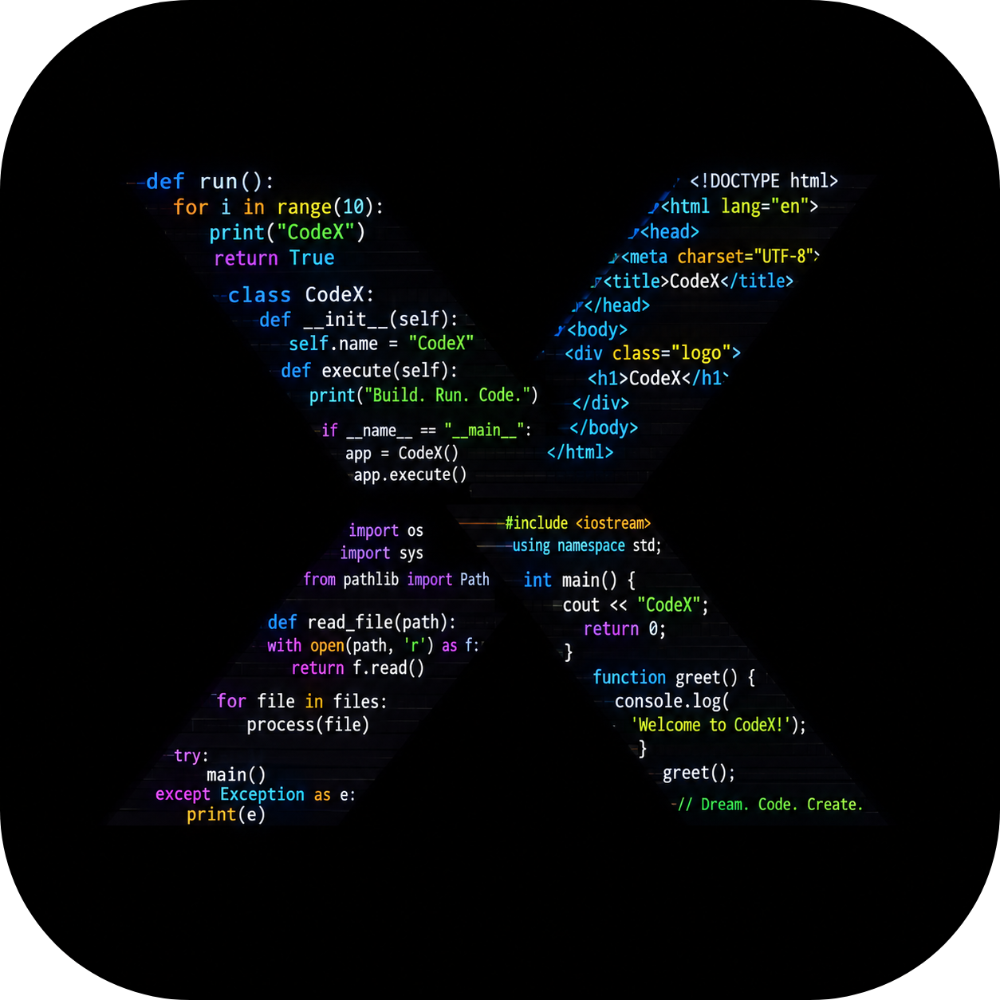

<div align="center">



# CodeX

**A modern, lightweight, AI-powered desktop code editor built with Python and PyWebView.**

[](https://www.python.org/)
[](https://pywebview.flowrl.com/)
[](LICENSE)

</div>

---

## 🌟 Overview

**CodeX** is a desktop code editor designed for developers who want a responsive, distraction-free environment paired with native AI coding capabilities. Built using a robust Python backend with **PyWebView (Qt / PySide6)** and a clean frontend powered by **CodeMirror**, CodeX delivers the speed of a native desktop application alongside modern development workflows.

---

## ✨ Features

- **🧠 Integrated CodeX AI (Chat & Agent Modes)**
  - **Chat Mode**: Discuss code, get architectural guidance, and troubleshoot errors with full project awareness.
  - **Agent Mode**: Prompt the agent to create or modify code across your project. Review proposed file changes and diffs inside an interactive review modal before applying them with a single click.
  - **Context-Aware**: Automatically feeds relevant project files into the AI context for accurate solutions.

- **💻 Rich Code Editor**
  - Syntax highlighting for 20+ languages (Python, JavaScript, TypeScript, HTML, CSS, Rust, Go, C/C++, Java, PHP, SQL, Markdown, YAML, TOML, and more) powered by CodeMirror.
  - Tabbed editing with unsaved change badges, line numbers, breadcrumbs, and dark theme (`material-darker`).

- **⚡ Live HTML & Web Preview**
  - Built-in local HTTP server serving your project files with automatic hot-reload detection (`X-CodeX-Version`).
  - Split-view preview frame with one-click external browser launching.

- **📟 Embedded Terminal**
  - Integrated PowerShell terminal rooted in the active project directory.
  - Real-time command output streaming and command history (`↑` / `↓` navigation).
  - Quick Python execution: run the active Python script instantly (`Ctrl + F5`).

- **📁 Project Explorer & File Tree**
  - Directory tree with VS Code style icons (via Iconify with fallback glyphs).
  - Create, open, rename, and delete project files safely within project bounds.
  - Fast full-text project search with line number highlights and jump-to-result navigation.

---

## ⌨️ Keyboard Shortcuts

| Shortcut | Action |
| :--- | :--- |
| <kbd>Ctrl</kbd> + <kbd>S</kbd> | Save current file |
| <kbd>Ctrl</kbd> + <kbd>O</kbd> | Open file dialog |
| <kbd>Ctrl</kbd> + <kbd>N</kbd> | Create new file |
| <kbd>Ctrl</kbd> + <kbd>F</kbd> | Find / Search in project files |
| <kbd>F6</kbd> | Toggle live HTML preview |
| <kbd>Ctrl</kbd> + <kbd>F5</kbd> | Save & run active Python script |
| <kbd>Ctrl</kbd> + <kbd>Enter</kbd> | Submit prompt in AI assistant |
| <kbd>Esc</kbd> | Dismiss Agent review modal |

---

## 📂 Project Structure

```text
CodeX/
├── main.py              # Application core: PyWebView bridge, preview server & terminal runner
├── requirements.txt     # Python dependencies
├── icon.ico             # Application window & executable icon
├── README.md            # Project documentation
└── ui/
    ├── index.html       # Workbench UI structure & CodeMirror integrations
    ├── app.js           # Frontend client logic & PyWebView JS API communication
    ├── style.css        # Dark theme styling, workbench layouts & animations
    ├── logo.png         # CodeX high-resolution brand logo
    └── icon.ico         # UI icon asset
```

---

## 🚀 Getting Started

### Prerequisites

- Python 3.10 or higher
- Windows (PowerShell support for built-in terminal)

### 1. Clone the Repository

```bash
git clone https://github.com/your-username/CodeX.git
cd CodeX
```

### 2. Set Up a Virtual Environment

```bash
# Create virtual environment
python -m venv .venv

# Activate virtual environment

- Powershell
.venv\Scripts\Activate.ps1

- CMD:
.venv\Scripts\activate.bat
```

### 3. Install Dependencies

```bash
pip install -r requirements.txt
```
(Replace API_URL on line 25)
### 4. Run CodeX

```bash
python main.py
```

---

## 📦 Building a Standalone Executable (.exe)

You can package CodeX into a standalone Windows desktop executable using **PyInstaller**:

```bash
pyinstaller --noconfirm --onedir --windowed --add-data "ui;ui" --icon "icon.ico" --name "CodeX" main.py
```

After compilation finishes, your ready-to-run desktop app will be located in the `dist/CodeX/` directory.

---

## 🛠️ Built With

- **[PyWebView](https://pywebview.flowrl.com/)** – Lightweight cross-platform GUI wrapper
- **[PySide6 / Qt](https://www.qt.io/)** – High-performance native GUI backend
- **[CodeMirror](https://codemirror.net/5/)** – Versatile in-browser text and code editor
- **[Requests](https://requests.readthedocs.io/)** – HTTP client for backend AI interactions

---

## 📄 License

This project is licensed under the MIT License - feel free to use, modify, and distribute.

---
# Made With ❤️ by <a href="https://sawwqib.rf.gd">Saqib</a>

If you like CodeX, consider giving this repository a star on GitHub!

---

## 👀 Views


